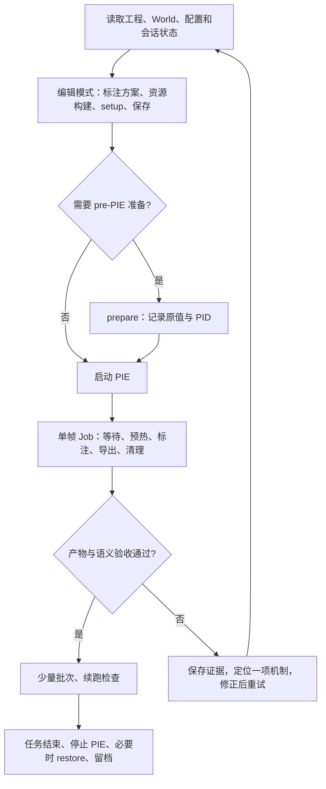

# Agent 接手与 UE 机制适配手册

PCG 场景先读 [PCG 流程与机制](pcg_workflow.md) 和 [2026-10-10 PCG 实测](validation/2026-10-10-pcg-baseline.md)。当前实现范围是一个受控 CPU、非分区、OnDemand PCGVolume；不可将其完成判据推广到 WP/GPU/Runtime Generation。

本手册描述当前能力、证据要求和恢复方法。逐脚本入口见 [人工操作指南](operator_guide.md)，已完成的真实测试见 [验证基线](validation/2026-10-09-capture-baseline.md)。不能只凭旧会话摘要推断当前编辑器状态，也不能把这里的推荐流程当成代码已经实现的自动保护。

## 1. 接手时先读什么

先读根目录 `AGENTS.md`，再读所选配置、本手册和最近的验证记录。检查 `git status`，保留用户及前序任务的改动。仓库有 `argus_core`、`argus_backends/ue`、`scripts/argus_components` 三层：纯数据逻辑留在 core，UE API 放适配 / 组件层，入口脚本负责编排。

最新已验证的默认场景是 CaptureLab，`pipeline_config.json` 为 generic；Big City 使用 `pipeline_citysample.json`。旧文档中的无参 CitySample 命令不再表示当前默认流程。

`output/` 被 Git 忽略，可能只存在于当前机器。历史编辑器 PID、MCP session ID、Slate 控件引用、任务变量、地图已打开等信息都必须重新确认。

## 2. 建立连接，读取事实

本机曾使用 `http://127.0.0.1:13001/mcp`。优先发现本轮可用 MCP 工具及其 schema，读取当前地图和 `IsPIERunning`。如果通过 HTTP 连接，完成 MCP 初始化并使用当前返回的 session；不要复用过期 session 文件。`ModelContextProtocol.StartServer 13001` 后出现旧 8000/8080 listener 报错，不足以判断 13001 失败，实际工具调用才是连接证据。

同一编辑器内的地图切换、Python 执行、PIE 启停、材质构建和采集请求串行调度。代码 / 文档读取和离线图片分析可以并行。MCP 返回 Type/Click=true 只表示 UI 请求被处理，不能代替 Python 成功日志或完成产物。

如果没有直接执行 UE Python 的工具，可以使用 Slate 的 Output Log 命令框。每次打开地图 / 重建 UI 后重新 Snapshot 获取控件引用；历史 `tb5` 等引用不可硬编码。曾发生 UE 不在前台时 Click 返回 true 但没有实际点击：确认目标编辑器窗口和进程、重新取快照、检查 Cmd / Python 模式，再检查日志中的唯一完成标记。不要反复盲点屏幕坐标。

开始前把这些事实写到本次记录中：

| 事实 | 读取 / 核对方法 |
| --- | --- |
| UE 版本、工程、编辑器 PID | 编辑器 / 项目路径、`unreal.SystemLibrary.get_engine_version()`、UE Python `os.getpid()` |
| 地图和 World | `UnrealEditorSubsystem.get_editor_world()` / `get_game_world()`，读取路径；PIE 采集须使用 game world |
| 场景机制 | WorldSettings 的 `world_partition`、`default_game_mode`；PIE 实际 `GameplayStatics.get_game_mode(world)`；是否有 Sequencer/Intro、运行时生成或 Data Layer |
| 配置与资产 | 显式 pipeline 路径、profile、assets.root、stream labels、RT、材质、位姿 CSV、输出路径 |
| 项目渲染条件 | `r.CustomDepth=3`，半透明材质 Custom Depth Writes，后处理阶段、RT 格式和 gamma |
| 会话和任务 | 是否已有活动 CaptureJob/批次；`output/runtime_play_session_state.json` 的 PID、profile、原值 |
| 未保存修改 | dirty map / 外部 Actor 包；切图前保留用户正在做的工作 |

不要为了让代码通过而把任意用户场景改成 GameModeBase。CaptureLab 的原生 GameMode 是受控测试基线；真实场景可能依赖自己的 GameMode、蓝图和子系统。

## 3. 按状态推进



对当前默认 CaptureLab，无需重复建图、构建资源或 prepare。读取状态符合预期后可直接 PIE 单帧。一般场景的具体 Python 命令见操作指南；自动规则试采与人工真值回写必须明确选择。

采集返回的 job 由 `unreal.register_slate_post_tick_callback` 推进。请求发出后返回控制权，在后续独立请求中查询 `done/error/result`；或注册完成回调把 JSON 写到本次实验目录。不能在 UE 线程里 sleep / busy wait，也不要在活动任务中热重载模块、切地图或先停 PIE 再等结果。

可使用这样的结束记录（UE Python，小脚本执行后立即返回）：

```python
import json
from pathlib import Path
from capture_rgb_and_mask import capture_once

def record_finished(job):
    path = Path(ROOT) / "output/validation/current_run/single_result.json"
    path.parent.mkdir(parents=True, exist_ok=True)
    path.write_text(json.dumps({
        "done": job.done,
        "error": str(job.error) if job.error is not None else None,
        "result": job.result,
    }, ensure_ascii=False, indent=2), encoding="utf-8")

job = capture_once(CFG, capture_id="unique_run_smoke")
job.add_done_callback(record_finished)
```

`ROOT`、`CFG` 按操作指南初始化，目录和 ID 换成本次唯一值。对批次查询 `done/success_count/failed_count/error`，不要假定 BatchCaptureRunner 也有 `add_done_callback`。重复按 F9 的保护仅属于 player-view 入口；普通单帧、批量之间没有全局互斥锁，agent 必须自己串行。

## 4. 根据机制调整，而非套用 CitySample 开关

先保存一帧基线及配置快照，每次只改变能由证据解释的设置，在相同位姿重拍，比较图像、stencil 分布、日志和耗时。项目专用配置放该项目预设；对所有场景成立的修复才进入共用代码。

| 机制 / 症状 | 先取证 | 调整方向与边界 |
| --- | --- | --- |
| 普通静态关卡 | 非 WP、对象都已加载、原生 / 简单 GameMode | generic；通常不移动玩家，不使用 CitySample 命令。CaptureLab 已验证 |
| 远景空洞 / WP 等待超时 | 当前玩家 ViewTarget、采集 pose、实际加载 Actor、Data Layer、查询状态 | 显式 pose；按需 `move_player_to_capture=true`。移动 SceneCapture 本身不保证成为已注册的流送源；当前临时组件主要用于查询 |
| 相机已移动但仍加载旧区域 | PlayerController 的 ViewTarget / PlayerCameraManager；是否被 Intro/Sequencer 接管 | UE 5.8 默认优先从 ViewTarget 取流送位置；另有强制相机分支。当前移动路径临时切换 ViewTarget，结束恢复；自定义相机管理器仍需实测 |
| 等待长时间仍不出现对象 | Data Layer 是否启用、网格范围、HLOD 替代、源 Actor 是否存在 | 先解决状态和源位置，再调 timeout / range。等待查询完成不保证 Data Layer 被激活、材质/纹理/Nanite/Lumen 已收敛 |
| CitySample 水面 / 原对象在 PIE 消失 | PIE 前后对象类型 / 路径、FastGeo 值 | 使用 CitySample prepare 在 PIE 创建前禁用转换；PIE 后再关已来不及。此处不要向普通地图复制 FastGeo 开关 |
| CitySample 开场抢镜头 | Sandbox Intro 状态、实际 ViewTarget | CitySample 预设在 PIE 前处理 Intro；其他项目应诊断自身开场逻辑 |
| Mass 卸载相关 ensure | 流送切换时的调用栈和日志时序 | CitySample 预设保留 `restore_player_after_capture=false` 降低回移卸载；临时 ViewTarget 仍会恢复。与此前 Python GC 崩溃的因果尚未证明 |
| MASK 全黑 | CustomDepth=3、正确 PIE Actor、组件开关/stencil、RT、后处理绑定 | 逐层排查；改变组件 stencil 不能补救未开启的项目 Stencil Pass；不要先改曝光 |
| MASK 颜色不在类别表 | 原始 PNG 颜色、RT 格式/gamma、材质位置 | RGB 为 sRGB/gamma 2.2，MASK 为 linear/gamma 1.0；核对 UE 5.8 `BL_SCENE_COLOR_AFTER_TONEMAPPING`。类颜色不可做有损压缩或双线性缩放后验收 |
| RGB 发黑 / 高光溢出 | 曝光、RT、灯光单位、Lumen 提示、预热前后图像 | 分开检查 sRGB 与曝光；CaptureLab EV12/40,000 lux 是场景参数，不是全局默认。Lumen 缓存预曝光范围查源码后调整 |
| 玻璃、水面在 MASK 缺失 | 材质 BlendMode、Allow Custom Depth Writes、组件设置 | 在相关材质和组件修正；不要把临时换不透明材质作为通用修复 |
| 背后物体出现在 MASK | 前景对象是否写 CustomDepth；比较 scene depth / custom depth 的设计 | CustomDepth 有独立遮挡集合。人工关闭前景 CustomDepth 后可能看到后面标签，不等于颜色或相机错误 |
| 屋顶被判道路、类别保留错误 | mesh/component 身份、共享材质、alias、已有非零 stencil | 自动规则是启发式；检查真值。`preserve_existing` 也会保留以前的错误值，改规则后不一定重算；在可恢复副本修正或明确回写 |
| 人工 ignore / mask-off 被重新启用 | 自动标注 enabled、已有 stencil 和 CustomDepth 前后值 | 人工真值流程关闭自动兜底。当前没有自动规则对人工排除对象的完整保护 |
| 一组件内材质槽 / ISM 实例类别不同 | `target_type`、组件粒度、实例数、planner 状态 | 当前后端不能直接逐槽/逐实例写不同 stencil；需拆分组件或设计代理。不能把 warning 当成已经支持，也不要整组件错误降级 |
| 运动物体两路边缘不一致 | pose/FOV/投影、暂停状态、动画/物理/时序渲染、WPO | 当前两路 SceneCapture 顺序渲染，暂停降低状态变化，不是同一 GPU 曝光的严格同步保证；调预热/时序特效后重新检验 |
| SkyAtmosphere 对应黑色 MASK | 是否真实天空网格 / stencil | 程序化天空默认背景。若数据集要求 sky 类，需额外分割策略并验证，不能假定天空 Actor 会自动出标签 |
| 异步任务慢、编辑器后台低帧率 | 所处等待/预热/标注/导出阶段、组件数、tick 间隔 | `components_per_tick` 控制标注分摊，256 是通用配置，4096 是 Big City 的实测取舍；导出/枚举仍同步，不能保证不卡顿 |

新 UE 机制不在表中时：先描述可复现现象和预期，再搜索本地 5.8 文档，读相关 Markdown，最后核对引擎 / 插件源码中的实际签名和执行阶段。不要仅凭 C++ 方法名推断 Python 方法名；实际踩过 `get_pawn` 不可用，改用 `GameplayStatics.get_player_pawn(world, 0)`。

## 5. 失败处理与尚未实现的保护

- **超时不是总任务截止时间。** `streaming_timeout_seconds` 在等待状态检查，不覆盖整个标注/导出。外部 agent 应记录阶段和壁钟时间，超时未见进展时停止提交新任务、保存日志、诊断编辑器是否仍 tick。当前没有公开的可靠取消 API；不要通过调用私有 `_finish` 或删除 callback 硬伪造完成。
- **运行时状态不是全部 CVar 的事务快照。** 会话适配器精确记录/恢复的 bool CVar 是 `FastGeo.EnableTransformer`、`CitySample.UseSandboxIntro`；任意新增控制台命令、加载范围等不保证自动恢复原值。新增设置应记录旧值、恢复方法和是否要求重建 PIE，检查命令 allowlist 及 rejected 列表。
- **会话文件不是配置哈希锁。** 当前 capture 会读取已有准备计划，不对整个当前配置作一致性校验；prepare/capture/restore 必须由 agent 保证同一预设。同 PID 下切配置先结束并恢复旧会话。崩溃后保留旧日志和状态副本，按新进程重新 prepare，不手工伪造 PID。
- **成功文件存在不等于数据集有效。** 断点策略检查 ID 和文件存在，不能发现配置变化、损坏 PNG 或类别错误。遇到不可读 metadata 时先修复 / 隔离记录，避免脚本按“无历史”重新采集覆盖同名文件。
- **失败不保证回滚所有产物。** 可能 RGB 已导出、MASK 失败，或 finalize 已写 metadata 后 cleanup 失败；只读核对完整性再续跑，保留失败现场。
- **PIE 对象有生命周期。** 完成任务已释放内部 UE 闭包，但自写回调/全局变量仍可能持有 Actor。不要跨停止/重启复用旧引用，不在活动任务中运行探针脚本的模块清理。编辑器崩溃保存 `Saved/Logs`、`Saved/Crashes`，区分已复现故障与推测；既有两次 Python GC 崩溃不能宣称根因已修复。
- **更换场景不等于更换项目。** CaptureLab 位于 CitySample 工程内，工程级音频/Mass 子系统仍可能启动；独立工程、其他 WP/GameMode、打包程序需要各自验收。

## 6. 验收和记录格式

agent 完成任务前应提供可核验的证据，不仅是“工具调用成功”：

1. 当前 World / 实际 GameMode、配置快照、插件/渲染必要条件；记录资源和源美术位置。
2. 单帧与至少几个有代表性的位姿，job 结果及 metadata；失败任务也要单独记录。
3. 文件可解码、尺寸/alpha/路径一致；按实际编码检查调色板或 stencil ID；对照对象真值/人工预览检查类别、轮廓与遮挡。`class_color` 的颜色重复必须披露。
4. 小批次成功/失败数、重跑跳过数、metadata 是否重复；捕获同名文件或配置变化风险。
5. 任务结束后暂停/ViewTarget/玩家恢复状态、PIE 停止、已 prepare 时的 restore；如本次改过生命周期逻辑，补针对性重启/失败清理测试。
6. 修改代码时运行相关测试，记录 UE 真实验证与 Python 单测各自范围；文档改动核对真实入口，不为文档变更声称又完成了实机回归。

将下面内容填入 `docs/validation/<日期>-<实验>.md`，图片、日志和逐帧明细放对应 `output/validation/`：

```text
目的 / 尚未证明的事项：
UE版本、工程、地图、编辑器PID、实际GameMode、WP/Data Layer：
配置/位姿/类别表快照位置与SHA256、代码版本或未提交diff：
基线 -> 观察证据 -> 修改 -> 复测结论：
capture_id、输出路径、尺寸、耗时、成功/失败/跳过：
调色板有效率、真值检查方式、已知重复颜色/无法标注区域：
错误日志、失败阶段、恢复动作与结果：
测试命令及结果（区分本次测试/引用历史）：
最终World、PIE、暂停/ViewTarget、CVar、dirty packages、会话文件：
实际查阅的本地UE文档/源码：
遗留限制及下一次验证建议：
```

快照、配置指纹和完整的阶段遥测目前需要操作者额外记录，尚未自动写入每帧 metadata。历史记录不要补造当时没有采集的指标。

## 7. UE 5.8 查询依据

本轮记录核对了以下本地文档 / 源码；后续修改仍须根据问题搜索并读对应段落：

- `D:/UE58Knowledge/web/markdown/scripting-the-unreal-editor-using-python.md`：Python 插件、编辑器与游戏运行环境边界。
- `D:/UE58Knowledge/web/markdown/world-partition-in-unreal-engine.md`：流送源、加载范围、Data Layer、HLOD。
- `D:/UE58Knowledge/web/markdown/post-process-materials-in-unreal-engine.md`：CustomDepth/Stencil、后处理位置及 temporal jitter。
- `E:/UE_5.8/Engine/Source/Runtime/Engine/Private/PlayerController.cpp`：`GetStreamingSourceLocationAndRotation` 的 ViewTarget/相机分支。
- `E:/UE_5.8/Engine/Source/Runtime/Engine/Public/WorldPartition/WorldPartitionSubsystem.h`：`IsStreamingCompleted` 查询接口。
- `E:/UE_5.8/Engine/Source/Editor/LevelEditor/Public/LevelEditorSubsystem.h`：`NewLevel` 的分区选项。

曝光、RT、GameMode 和建图 API 的前次核对路径另见 [CaptureLab 指南](capture_lab.md) 与 [基线记录](validation/2026-10-09-capture-baseline.md)。
