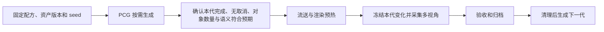

# UE 5.8 PCG 调研：面向 Argus 的程序化地图

日期：2026-10-10。依据本机 `D:/UE58Knowledge` 的 UE 5.8 文档及 `E:/UE_5.8` 的实际插件/引擎源码。本文是技术调研和实施建议，**尚未创建或运行 PCG Graph，也未证明当前 Argus 已支持所有 PCG 输出模式**。

## 1. 建议的起点

先在独立的小型普通关卡做 **CPU PCG、非分区、按需生成、按类别组织组件**。用现有道路/建筑/树木/车辆素材生成可控布局，生成完成并核对语义后，再接现有 RGB/MASK 采集。保持 CaptureLab 作为固定回归基线。

第一阶段建议：

- 地图约 100×100 米，原生 GameMode、固定灯光，不带 CitySample 开场/交通生成逻辑。
- 路网/地块采用明确的网格或 spline 规则；树木、车辆、街道小物件由 PCG 按区域和间距规则放置。
- 显式控制 seed、素材集合、密度、楼层、退界、禁放区域和相机位姿。
- 在生成阶段写入确定的类别及 stencil，不依赖 Actor 名称猜测真值。
- 同一个已生成场景采完全部视角后，才清理或换 seed。

建议先用标准 CPU Static Mesh Spawner，必要的复杂对象使用 Spawn Actor。Runtime Generation、World Partition、大规模 GPU 和 FastGeo 作为后续独立验收项。

## 2. PCG 能提供什么

PCG 用图表达“输入空间/属性 → 采样点 → 过滤与变换 → 选择素材 → 生成对象”。点包含位置、旋转、缩放、边界、密度、seed，也可携带自定义 metadata。一个图可拆成子图并暴露参数。

| 地图工作 | 可用能力 | 我们仍需编写的规则 |
| --- | --- | --- |
| 路网和地块骨架 | Create Points Grid、Spline 数据/采样、属性、子图 | 道路连通性、路口、地块划分、出入口与尺寸约束 |
| 道路/围栏/立面模块排列 | Spline Sampler、Shape Grammar、Subdivide Spline | 模块接口、转角、楼层、闭合、退界；处理无法完整填充的段 |
| 树木/道具/停车位 | Surface/Spline Sampler、Transform Points、Self Pruning、Difference/过滤 | 排除道路、建筑和相机通道，按真实 mesh bounds 控制碰撞/间距 |
| 素材选择 | Weighted、By Attribute、Weighted By Category | 类别到资产表、抽样权重、版本与可用性检查 |
| 大地图分层 | Partitioned / Hierarchical Generation | 各网格大小、生成半径、Data Layer/HLOD 策略和采集时的就绪条件 |
| 地形交互 | Landscape 采样；Mesh Terrain Query/Write 等 | 真正的地形生成/侵蚀规则、插件要求、反馈循环与渲染验证 |

完整城市拓扑、合法道路布局、建筑结构和数据集真值都需要我们设计。PCG 提供可组合的生成机制；第一版采用规则街区更容易控制覆盖范围和验收。

Shape Grammar 特别适合已有模块的组合，例如底层/重复楼层/屋顶、围栏与人行道。官方文档明确提示紧急转角可能产生不正确结果，模块无法填满 spline 时也需要明确处理，不应直接忽略 warning。

## 3. 分清生成触发、分区与执行后端

这些是可组合的不同维度，不能把“PCG 分区”与“地图启用 World Partition”视为同一个开关。

| 维度 | 选项 / 行为 | 对 Argus 的影响 |
| --- | --- | --- |
| 空间组织 | 非分区；分区；Hierarchical 多级网格 | 从单域到多个局部执行单元，就绪统计和对象归属逐渐复杂 |
| 生成触发 | GenerateOnLoad、GenerateOnDemand、GenerateAtRuntime | MVP 使用 OnDemand，明确控制何时变化 |
| 执行位置 | CPU 或支持的 GPU 节点 | GPU 生成实例的数据访问、持久化和渲染能力不同 |
| 输出形式 | CPU ISM/HISM、Actor、GPU procedural instances、实验性 FastGeo primitives | 当前组件枚举/标注/清单导出不能默认覆盖所有形式 |

Hierarchical Generation 需要 partitioned component，大网格数据向小网格流动；跨网格可能复制点，文档建议用 Cull Points Outside Actor Bounds 等控制重复。网格越细不一定越快，需要考虑工作重复和调度开销。

Runtime Generation 根据 generation sources、半径、清理倍率和可选视锥规则生成/删除内容。来源可包括玩家、编辑器视口、World Partition 流送源和 PCG Generation Source Component。相机移动可能改变当前存在的场景，因此不能直接拿它做“固定地图多视角真值”而不冻结生成范围。

## 4. 最重要的接入问题：语义必须随生成结果保存

建议图中每个生成对象/点有以下逻辑字段。它们是待实现的数据约定，不是现有 Argus 已自动支持的字段：

| 字段 | 用途 |
| --- | --- |
| `semantic_class`、`stencil_id` | 来源于版本固定的 `semantic_classes.csv` |
| `asset_id` / 资产路径 | 对应真实素材与版本 |
| `instance_id` | 本次生成中可追踪的逻辑 ID；不要依赖易变化的 Actor 名称或 ISM 下标 |
| `source_rule` / 子图 | 能解释为什么生成该对象 |
| `generation_id`、seed、参数摘要 | 将场景、图版本与采集批次关联 |

### 4.1 普通 ISM/HISM 的 stencil 是组件级

当前 UE CustomStencil 后端按 PrimitiveComponent 写一个 stencil。一个 ISM 内多个实例不会因具有不同 PCG metadata / PerInstanceCustomData 就自动得到不同 CustomStencil。

第一版按 semantic_class 分支：道路、人行道、建筑、树、车辆、道具分别生成，每个输出组件只承载一种类别。在 spawner 的 descriptor/template 设置 `bRenderCustomDepth=true` 和对应 `CustomDepthStencilValue`，然后读取实际生成组件验证。CPU Weighted selector 的各 Mesh Entry 也具有 descriptor，可在同类别分支选择多种素材。

源码给出了另一条可研究路径：

- `UPCGStaticMeshSpawnerSettings::StaticMeshComponentPropertyOverrides` 能把点属性映射到 ISM descriptor；头文件注明当前用于 **SelectByAttribute**。
- `PCGMeshSelectorByAttribute.cpp` 按有效覆盖属性组合划分点集合，再为分组建立 descriptor。
- `FISMComponentDescriptor` 包含 `CustomDepthStencilValue` 与 `bRenderCustomDepth`；相等比较和组件初始化都处理这些字段。

因此将 stencil 纳入 descriptor 分组有源码依据，但仍需实机测试。不能只给点加一个类别属性就认为材质/组件会自动使用它。相同 descriptor 的数据可能合并；`bAllowMergeDifferentDataInSameInstancedComponents` 默认 true，类别边界必须落实在 descriptor 或明确的输出组织中。

### 4.2 Spawn Actor 适合哪些对象

建筑蓝图、需要独立行为/组件或明确 Actor 归属的对象可用 Spawn Actor。核对 No Merging / Collapse Actors / Merge PCG 的实际设置；Collapse 路径可能改变组件和标签归属，不能假设一个点始终对应一个独立 Actor。

模板或 post-spawn 逻辑必须将类别写到各个实际渲染组件。一个建筑蓝图包含多个类别时仍需逐组件处理。将 Actor Attach 到父对象也会耦合流送；“放进同一 Outliner 文件夹”与 Attach 不等价。

### 4.3 与当前自动标注的关系

PCG 生成物有确定真值时，建议关闭 `runtime.auto_semantic_stencil.enabled`，同时保证所有静态底图对象也已通过明确规则标注。当前自动兜底会重新启用某些人工关闭的 CustomDepth，并可能按命名覆盖未标注对象的预期策略。

现有 inventory 并不自动保存 PCG metadata 和完整的逐实例来源映射，后续需要额外导出生成清单。PCG 重新生成/清理可能替换组件，旧组件引用、名称和实例下标不能作为跨代真值标识。

## 5. 生成结束不等于现在就能采集

推荐的过程：

当前 Argus 只实现了既有流送/预热/标注等阶段，**尚无 PCG generation barrier**。后续应增加生成控制适配层，将 PCG 的本代完成、目标输出覆盖及清理状态作为进入 CaptureJob 的前置条件。不能将 `IsStreamingCompleted` 当成“PCG 也完成了”。

UE 5.8 源码中的关键接口：

| 位置 / 接口 | 查到的事实 | 自动化注意点 |
| --- | --- | --- |
| `UPCGComponent::SetGraph`、`GenerateLocal(bool)`、`CleanupLocal(bool)` | 有 BlueprintCallable/UFUNCTION；生成/清理会延迟执行 | 调用后交还编辑器 tick，不能忙等 |
| `OnPCGGraphGeneratedExternal` / Cancelled / Cleaned | BlueprintAssignable 外部事件 | 可作为完成信号来源；Python delegate 的具体绑定方式需反射/实机确认 |
| `IsGenerating()`、`IsCleaningUp()`、`CancelGeneration()` | C++ 接口在核对的头文件中没有 UFUNCTION | 不要凭 C++ 名称假写 Python `is_generating()`；必要时加很薄的 Blueprint/C++ 桥接 |
| `bGenerated` | 源码注释明确：partitionable actors 该标志始终 false | 不能用一个 bool 作为所有模式的完成判定 |
| `GetGeneratedGraphOutput()` | 可取得 graph 输出 collection | 最终清单应有明确输出 pin/导出设计，不假定所有中间点自动保留 |
| `ClearPCGLink()` | 把托管生成资源移交新 Actor 并解除 PCG 联系 | 可研究用于冻结快照；在独立快照副本操作，保留可编辑图和配方；解除后验证归属和语义 |
| `UPCGGraph::AddNodeOfType`、`AddEdge` | 反射可调用的建图接口 | 参数、返回 tuple 和 pin label 必须检查实际 Python API，不使用旧版示例的猜测签名 |
| `UPCGGraphFactory::bSkipTemplateSelection` | 建图工厂提供跳过模板选择选项 | agent 自动建图应避免模板弹窗阻塞，具体反射可访问性需验证 |

多组件、子图、分区和运行时调度会增加完成语义的复杂度。记录目标组件集合和本次 generation ID，忽略旧回调；事件完成后还要检查输出数量、类别和错误日志，不能把“图结束”当作“内容正确”。

## 6. GPU、FastGeo、Python Interop 的适用边界

本机插件元数据：核心 `PCG.uplugin` 位于 `Engine/Plugins/PCG`，`IsBetaVersion=false`、`EnabledByDefault=true`。这不能证明当前工程已实际加载，实施时仍需检查工程和编辑器能力。

| 能力 | 本机文档 / 源码状态 | 本项目建议 |
| --- | --- | --- |
| CPU PCG 图与常规 ISM/HISM | 核心路径，组件和 descriptor 可检查 | 第一版主路径 |
| PCGPythonInterop | 独立可选插件，Beta、Editor 模块、默认未启用；有 Execute Python Script / Data Processor | 可辅助编辑器工作；不要求为了通过 Python 调反射 API 而启用它，也不能把图内 Python 节点当打包运行方案 |
| GPU Static Mesh Spawner | 文档标 Experimental；使用不以 CPU 实例数据为后端的 `UPCGProceduralISMComponent` | 先独立证明标签、清单和渲染兼容性，再考虑优化 |
| PCGFastGeoInterop | Experimental，默认未启用；存在 component-less primitive 路径 | 当前依赖 UObject/PrimitiveComponent 枚举的 Argus 不能默认兼容 |
| PCG Biome Core/Sample | 本机 Biome Core 为 Experimental | 适合后续自然环境扩展，首轮街区不引入额外系统 |

GPU procedural instancing 文档明确列出：实例只在运行时 GPU 内存中，不能按普通 CPU 实例持久保存；静态烘焙光照/HLOD 以及依赖 CPU 实例信息的碰撞/物理、导航、光追、Distance Field lighting 等存在不支持项。GPU Weighted selector 还可能因点 seed 初始化不正确导致分配饱和和实例缺失。

这些限制与“可以把部分点运算放到 GPU”不是一回事；点计算、CPU/GPU 数据交换、最终实例生成路径要分别选择和验证。不要将所有 PCG GPU 功能一概视为可替代 CPU 输出。

## 7. 可复现性与数据集设计

seed 是必要条件，不是完整实验描述。`UPCGSettings::GetSeed` 会组合节点和执行源 seed；点位置、节点变换、输入顺序、资产集、图版本及引擎版本都可能影响结果。

每个 generation 建议归档：配方 JSON、graph 版本/哈希、资产清单、component/node seed、输入几何/spline、生成清单、类别表版本、相机位姿、渲染设置及 UE 版本。对重建结果比较按逻辑 ID 排序的资产、类别、transform 与数量；不要宣称跨版本/跨 GPU 图像逐字节一致。

建议拆分随机维度：布局 seed、资产 seed、道具 seed、外观/光照 seed 和相机 seed。这样能固定地图只改变光照，或固定类别密度只改变布局，便于定位差异。训练/验证集合至少按地图生成配方或布局 seed 分组，避免同一地图的近邻视角同时进入不同集合。

现有断点续跑只检查 capture_id 和文件存在。新增 PCG 流程应将 generation ID/配方指纹纳入输出目录和采集 ID，或新增一致性校验；换 seed 后继续使用相同 ID 会误跳过旧图。

## 8. 分阶段实施建议

以下脚本名和能力是**待实现建议**，不是仓库现有入口。

| 阶段 | 工作 | 验收门槛 |
| --- | --- | --- |
| P0：能力探测 | 只读确认 PCG 插件、Python 反射类、建图/事件接口；保存实际 API 清单 | 不改现有关卡；确认无需猜测调用签名 |
| P1：最小语义图 | 新建 `/Game/Argus/PCG/Maps/Argus_PCG_Lab`；固定地面/道路、按类生成树/车/道具；CPU、非分区、OnDemand | 图可重复生成、清理；同 mesh 在不同类别输出时组件 stencil 隔离正确 |
| P2：采集接入 | 待建生成控制/清单导出，等待本代完成，调用现有单帧/批量 | 多视角 RGB/MASK 正确、无生成中采集、重载/PIE 后清单与标签一致 |
| P3：可变街区 | 增加道路/地块/楼层/素材/密度规则，seed 批次 | 10 个 seed 的初步矩阵；重复 seed 可复现布局，新 seed 产生可解释变化；道路/相机通道不被阻挡 |
| P4：规模化 | WP/HiGen/Runtime、GPU 或 FastGeo 各自独立评估 | 生成、清理、相机移动、语义完整性、性能和失败恢复均有证据 |

建议未来入口职责：`build_pcg_scene.py` 负责图/场景构建，生成控制适配层负责异步 generation 生命周期，`export_pcg_manifest.py` 负责逻辑实例和组件对应，现有 `capture_rgb_and_mask.py` / `batch_capture.py` 继续负责采集。不要让捕获脚本同时承担地图布局算法。

最小验收矩阵还应包括：同 seed 清理重建、保存重载、PIE 两次启动、缺失资产、取消/失败/超时、未写 stencil 对象、忽略对象、组件合并、部分生成、相机移动与续跑。场景组件数和像素类别覆盖都要检验，调色板有效率本身不证明语义正确。

## 9. 参考资料

本地知识库页面声明 version_requested=5.8，但部分正文链接仍带历史 `application_version=5.5`。本文没有把这些历史链接当作接口依据；精确行为优先核对本机 5.8 源码。GPU 等能力尚待实机验证。

官方页面（对应本机文档来源）：

- [PCG Overview](https://dev.epicgames.com/documentation/en-us/unreal-engine/procedural-content-generation-overview?application_version=5.8)
- [Generation Modes](https://dev.epicgames.com/documentation/en-us/unreal-engine/using-pcg-generation-modes-in-unreal-engine?application_version=5.8)
- [Node Reference](https://dev.epicgames.com/documentation/en-us/unreal-engine/procedural-content-generation-framework-node-reference-in-unreal-engine?application_version=5.8)
- [PCG with GPU Processing](https://dev.epicgames.com/documentation/en-us/unreal-engine/using-pcg-with-gpu-processing-in-unreal-engine?application_version=5.8)
- [Shape Grammar](https://dev.epicgames.com/documentation/en-us/unreal-engine/using-shape-grammar-with-pcg-in-unreal-engine?application_version=5.8)
- [PCG with World Partition](https://dev.epicgames.com/documentation/en-us/unreal-engine/using-pcg-with-world-partition-in-unreal-engine?application_version=5.8)

实际阅读的本地 Markdown：

- `D:/UE58Knowledge/web/markdown/procedural-content-generation-overview.md`
- `D:/UE58Knowledge/web/markdown/using-pcg-generation-modes-in-unreal-engine.md`
- `D:/UE58Knowledge/web/markdown/procedural-content-generation-framework-node-reference-in-unreal-engine.md`
- `D:/UE58Knowledge/web/markdown/using-pcg-with-gpu-processing-in-unreal-engine.md`
- `D:/UE58Knowledge/web/markdown/using-shape-grammar-with-pcg-in-unreal-engine.md`
- `D:/UE58Knowledge/web/markdown/using-pcg-with-world-partition-in-unreal-engine.md`
- `D:/UE58Knowledge/web/markdown/pcg-and-mesh-terrain-in-unreal-engine.md`

关键源码（下列路径均位于 `E:/UE_5.8/Engine/`）：

- `Plugins/PCG/PCG.uplugin`
- `Plugins/PCG/Source/PCG/Public/PCGComponent.h`
- `Plugins/PCG/Source/PCG/Private/PCGComponent.cpp`
- `Plugins/PCG/Source/PCG/Public/PCGGraph.h`
- `Plugins/PCG/Source/PCGEditor/Private/PCGGraphFactory.h`
- `Plugins/PCG/Source/PCG/Public/Elements/PCGStaticMeshSpawner.h`
- `Plugins/PCG/Source/PCG/Private/Elements/PCGStaticMeshSpawner.cpp`
- `Plugins/PCG/Source/PCG/Public/Elements/PCGSpawnActor.h`
- `Plugins/PCG/Source/PCG/Public/MeshSelectors/PCGMeshSelectorWeighted.h`
- `Plugins/PCG/Source/PCG/Private/MeshSelectors/PCGMeshSelectorByAttribute.cpp`
- `Plugins/PCG/Source/PCG/Private/Components/PCGProceduralISMComponent.h`
- `Plugins/PCG/Source/PCG/Private/PCGSettings.cpp`
- `Source/Runtime/Engine/Public/ISMPartition/ISMComponentDescriptor.h`
- `Source/Runtime/Engine/Private/ISMPartition/ISMComponentDescriptor.cpp`
- `Plugins/PCGInterops/PCGPythonInterop/PCGPythonInterop.uplugin`
- `Plugins/PCGInterops/PCGPythonInterop/Source/PCGPythonInteropEditor/Public/Elements/PCGExecutePythonScript.h`
- `Plugins/Experimental/PCGInterops/PCGFastGeoInterop/PCGFastGeoInterop.uplugin`
- `Plugins/Experimental/PCGBiomeCore/PCGBiomeCore.uplugin`
